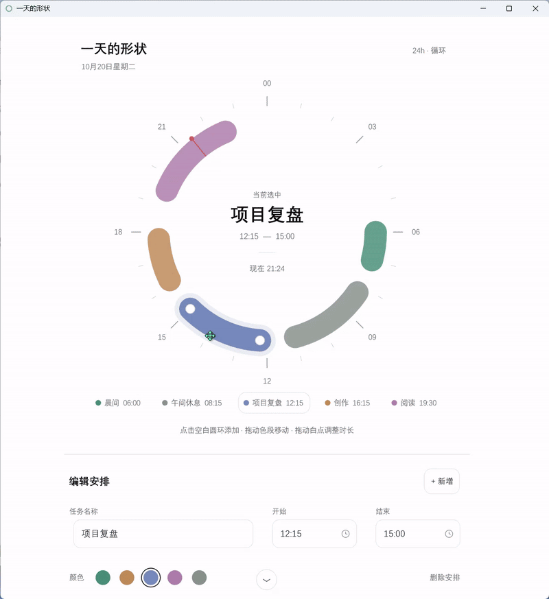

# Dayring

Windows 上的日程小工具，把一天画成 24 小时圆环。拒绝00:00~24:00的死板安排。用大致时段安排少数重要的事，看见时间的占用，也为休息和切换思路留出余地。

<p align="center">
  <a href="docs/media/dayring.mp4">
    
  </a>
</p>

[查看原视频](docs/media/dayring.mp4)

## 能做什么

### 一圈就是一天

00:00 在正上方，时间顺时针走，转一圈回到午夜。色段的位置表示开始和结束，弧长表示占用的时间。红针指向现在，空白处是还没安排的时间。

启动后不选中任务，中心显示当前时段的安排，没有安排时留空。选中任务后可连续修改名称、时间和颜色；点击背景或在未编辑时按 Esc，回到当前进行的安排。

### 直接在圆环上安排

点击空白处新建，拖动色段换个时间，拖动两端白点调整长短。点击圆环中心的名称和时间直接编辑，选中后在圆环内侧的弧形控件中换色或删除。

只安排大致的时段，不必精确到每一分钟。时间按 15 分钟对齐，每段最短 15 分钟。

### 跨过午夜，仍是一段

23:00–01:00 的安排顺着圆环经过午夜，连续显示为两小时的色段。

你可以晚上 23:00 休息，第二天 08:00 开始新的一天；也可以开发到凌晨 01:00，再留一个 Codex 夜间任务跑到早上 10:00，起床验收后才结束这一天的安排。

午夜只是一个刻度。一天从哪里开始、在哪里结束，跟着自己的作息走，跨到第二天的部分仍在同一个圆环上。

### 一天只安排几件事

以一天 6–8 件主要任务为尺度，把注意力留给少数重要的事，也给计划之外留出空白。后续会加入任务数量上限，让这份取舍成为产品的一部分。

### 给切换留点余地

色段用半圆端点柔和收尾，视觉上越过起止刻度。任务之间需要休息、收尾，也需要换一换思路，不必把每个端点都看成一道硬切线。

后续计划提供不同饱和度的端点延伸表现，让这份切换余量贴合各自的节奏。

## 操作

| 操作 | 作用 |
| --- | --- |
| 点击圆环空白处 | 从该时间起新增一小时安排 |
| 点击色段或下方标签 | 选中安排 |
| 拖动色段 | 移动安排，时长不变 |
| 拖动选中任务两端的白点 | 调整开始或结束时间 |
| 点击圆环中心的名称或时间 | 选中并原位编辑名称或起止时间 |
| 圆环内侧的弧形控件 | 选择五种颜色之一，或删除安排 |
| 时间旁的时钟 | 选择小时，分钟可选 00、15、30、45 |
| Enter | 提交当前字段，保留任务选中 |
| Esc | 结束拖动、关闭时间弹窗或取消当前字段编辑；无编辑操作时退出选中 |
| 点击背景 | 提交当前字段，退出选中并回到当前进行 |
| Delete | 无字段编辑、弹窗或拖动操作时，删除选中安排并回到当前进行 |
| 撤销 / Ctrl + Z | 恢复并选中最近删除的安排；编辑文字时不触发任务恢复 |
| Tab / Shift + Tab | 在名称、开始、结束之间切换 |

拖动、换色或提交字段后仍保留选中，可继续修改同一任务。时间输入无效时会停留在原字段，修正或按 Esc 取消后才能离开。

## 运行

在 Windows 上从源码运行，需要 Rust 工具链。在项目目录运行：

```powershell
cargo run
```

第一次启动会带上五个示例安排，可以直接修改。改动自动保存，下次打开继续使用。

构建不带控制台窗口的版本：

```powershell
cargo build --release
```

生成的程序在 `target\release\dayring.exe`。

## 数据

日程只保存在本机，Dayring 不联网。默认文件：

```text
%APPDATA%\Dayring\schedule.json
```

换一个文件：

```powershell
cargo run -- --data D:\notes\today.json
```

日程文件无法解析时，会尝试将原文件备份为同目录下的 `.json.bak` 文件，再恢复示例安排。

## 友情赞助

感谢 supporter [Nongfsq](https://github.com/Nongfsq) 对 Dayring 的友情赞助与支持。

也推荐他的 [frun](https://github.com/Nongfsq/frun)：Windows 上的轻量程序启动器。按 `Alt + Space`，输入名称，回车打开应用。
